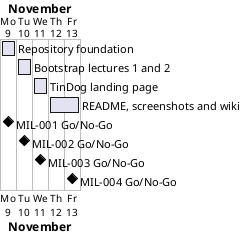

# Project Plan

## Metadata
| Key | Value |
| --- | --- |
| ID | PP-001 |
| CrossReference | [BC-001], [SA-001] |
| Language | en |
| Domain | it |

## Version History
| Date | Status | Author | Reviewer | Change | Commit |
| --- | --- | --- | --- | --- | --- |
| 2026-11-09 | Accepted | Jens Tirsvad Nielsen | AI as stand-in for S01 | Initial version | [109e51b] |

---

## Purpose

This plan schedules the four gateways that deliver the Day 58 TinDog project described in [BC-001]: the repository foundation, the first two Bootstrap lecture steps, the TinDog landing page, and the README, screenshots and trilingual wiki. It schedules them over the Business Case constraint of one branch and one pull request per milestone.

## Planning Assumptions

- Week 1 starts 2026-11-09; the plan ends by 2026-11-13.
- Each gateway lasts one working day and is delivered by one pull request.
- Communication follows [SA-001]: S01 accepts the plan in chat, then receives a run summary (COM-001).
- Work runs in autonomous mode: the AI is S01's stand-in for reviews and says so on every `RC-*`.

## Gateway Schedule

| Gateway | Document | Window | Decision date | Owner | Stories | Main deliverable | Milestone |
| --- | --- | --- | --- | --- | --- | --- | --- |
| Repository foundation | [MIL-001] | 2026-11-09 | 2026-11-09 | S01 | none | Python project skeleton, project documents, repository description and topics | [MIL-001](https://git.tirsystem.com/Tirsvad-Udemy-100-days-of-code/058-tindog/milestones/379) |
| Bootstrap lectures 1 and 2 | [MIL-002] | 2026-11-10 | 2026-11-10 | S01 | none | Lesson catalogue, local server, introduction page and "Move It" page, with tests | [MIL-002](https://git.tirsystem.com/Tirsvad-Udemy-100-days-of-code/058-tindog/milestones/380) |
| TinDog landing page | [MIL-003] | 2026-11-11 | 2026-11-11 | S01 | none | The TinDog landing page, with tests | [MIL-003](https://git.tirsystem.com/Tirsvad-Udemy-100-days-of-code/058-tindog/milestones/381) |
| README, screenshots and wiki | [MIL-004] | 2026-11-12 to 2026-11-13 | 2026-11-13 | S01 | none | Screenshots, README, and the wiki in English, Danish and Bahasa Malaysia | [MIL-004](https://git.tirsystem.com/Tirsvad-Udemy-100-days-of-code/058-tindog/milestones/382) |



## Scope Coverage

| Business Case scope item | Gateway |
| --- | --- |
| Static pages for lecture steps 1 to 3 | [MIL-002], [MIL-003] |
| Standard-library Python server and `constants.py` | [MIL-001], [MIL-002] |
| `pyproject.toml`, `.gitignore`, `Doxyfile`, README, `.venv` instructions | [MIL-001], [MIL-004] |
| `pytest` tests | [MIL-002], [MIL-003] |
| Screenshots per lecture step | [MIL-004] |
| Wiki in English, Danish and Bahasa Malaysia | [MIL-004] |
| Repository description and topics | [MIL-001] |
| Project documents and review records | [MIL-001] |

## Dependencies

```
MIL-001 → MIL-002 → MIL-003 → MIL-004
```

A No-Go on a gateway moves every later gateway, and the end date 2026-11-13, by the days needed to fix and re-review it. S01 decides any move of the end date.

## Plan Risks

| Risk | Impact | Mitigation |
| --- | --- | --- |
| The Udemy download link has expired (Business Case risk: the download link has expired) | MIL-003 has no reference files | Build the page from the lecture description; record the difference in [MIL-003] |
| Docker is not available for screenshots (Business Case risk: the CDN or network is unavailable) | MIL-004 slips | Stop and report; the host desktop is never used for GUI work |
| The wiki is not enabled (Business Case assumption: the wiki is enabled) on the repository | Wiki cannot be published | Enable it through the git host API if the token allows; otherwise report it |

## Open Issues

- The Day 58 lecture titles come from the assignment text, not from the course video list; the lecture step names are chosen by this project.
- Whether the repository is public decides if `docs/ai-prompts/` is ignored (`framework/process/ai-prompt-log.md`); it is checked at MIL-001.

---

[BC-001]: ./business-case.md
[SA-001]: ./stakeholder-analysis.md
[MIL-001]: ./milestones/mil-001-repository-foundation.md
[MIL-002]: ./milestones/mil-002-bootstrap-lectures-1-2.md
[MIL-003]: ./milestones/mil-003-tindog-landing-page.md
[MIL-004]: ./milestones/mil-004-readme-screenshots-wiki.md
[109e51b]: https://git.tirsystem.com/Tirsvad-Udemy-100-days-of-code/058-tindog/commit/109e51b66de566b81925c85b7a93dcf006cf5b95
